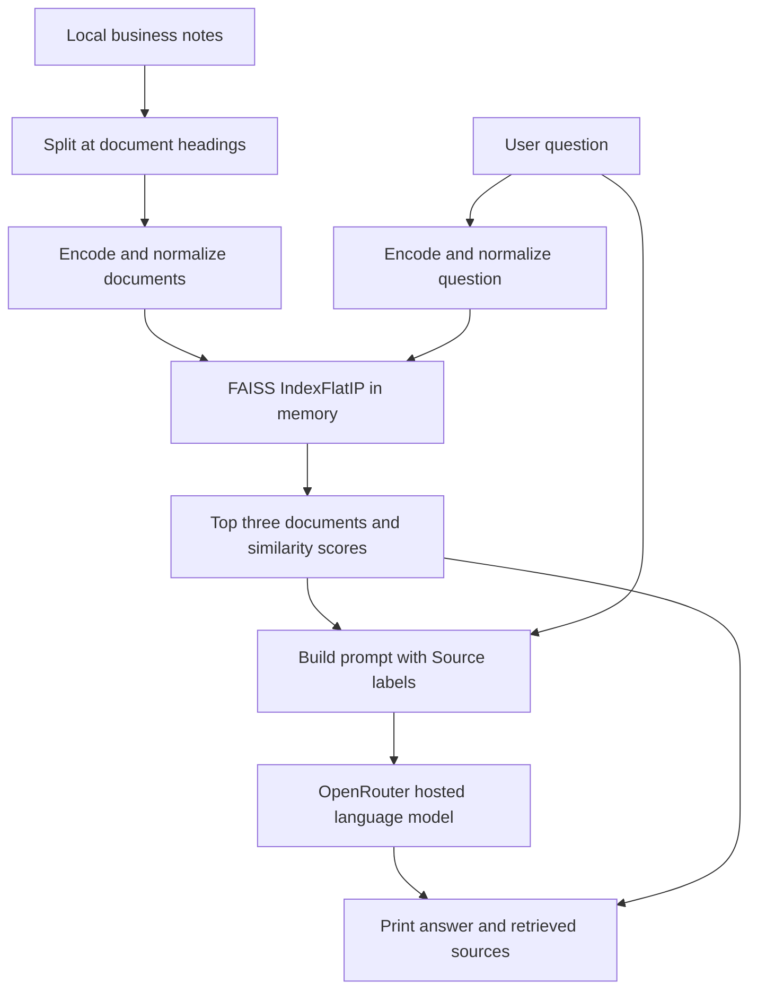

# AI Business Research Assistant

A Python command-line prototype that retrieves relevant business notes and supplies them to a hosted language model to generate an answer with source labels.

**Author:** Thow Zhi Cheng · **Status:** Portfolio / learning prototype · **License:** MIT

## Problem and approach

Business notes can be difficult to search when a question uses different wording from the documents. This project uses semantic search to retrieve notes by meaning, then uses retrieval-augmented generation (RAG) to turn those notes into a structured response.

The included dataset contains five short demonstration notes about website design businesses. It has no external references, publication dates, or verified market statistics. This is a demonstration of an AI workflow, not a validated market research product.

## Implemented features

- Load UTF-8 notes and split them at `[Document N: Title]` headings.
- Embed documents and questions using `sentence-transformers/all-MiniLM-L6-v2`.
- Search an in-memory FAISS index using normalized vectors and inner-product similarity.
- Retrieve up to three documents per question.
- Send retrieved context to OpenRouter through the OpenAI Python client.
- Ask the model to cite `[Source N]`, distinguish findings from suggestions, and acknowledge missing evidence.
- Print the answer and retrieved documents with similarity scores.
- Run standalone semantic-search and LLM-integration demos.

Citation correctness and evidence sufficiency are prompted behaviors; the program does not automatically verify them. There is currently no web interface, web search, PDF ingestion, persistent index, or automated quality benchmark.

## Quick start

Run these commands from PowerShell. Use a Python installation compatible with the packages in `requirements.txt`; the existing local environment uses Python 3.14.7. Other Python versions have not been verified for this snapshot.

```powershell
git clone https://github.com/THOWZHICHENG/AI-Business-Research-Assistant.git
cd AI-Business-Research-Assistant
python -m venv .venv
.\.venv\Scripts\python.exe -m pip install -r requirements.txt
if (-not (Test-Path .env)) { Copy-Item .env.example .env }
```

Edit your local `.env` and set your own key:

```dotenv
OPENROUTER_API_KEY=your_openrouter_api_key_here
```

Run the full pipeline:

```powershell
.\.venv\Scripts\python.exe code/rag_pipeline.py
```

Example question: `How can a website design agency differentiate itself?`

The first run needs internet access to download the embedding model. Full RAG also needs access to OpenRouter. The code requests `openrouter/free`; provider availability, routing, account access, limits, and pricing should be checked before running. This repository makes no guarantee of free or available inference.

See [installation and troubleshooting](docs/SETUP.md) for Windows, macOS, Linux, and all three scripts.

## How it works



The model is not trained or fine-tuned by this project. Retrieved text is provided as context at request time. See [architecture and decisions](docs/ARCHITECTURE.md).

## Technology stack

| Component | Role |
| --- | --- |
| Python | CLI scripts, document loading, prompt construction |
| Sentence Transformers | Local text embeddings |
| NumPy | Float32 vectors for FAISS |
| FAISS CPU | Exact similarity search |
| OpenAI Python client | OpenAI-compatible requests to OpenRouter |
| python-dotenv | Load the API key from `.env` |

Using the OpenAI client here does not mean the program calls OpenAI-hosted models: its base URL points to OpenRouter. LangChain and Streamlit are not used.

## Repository structure

```text
AI-Business-Research-Assistant/
├── code/
│   ├── semantic_search.py       # Retrieval without hosted generation
│   ├── llm_integration.py       # Hosted generation without retrieval
│   └── rag_pipeline.py          # Retrieval plus hosted generation
├── data/
│   ├── business_research.txt    # Five demonstration notes
│   └── README.md                # Data format and limitations
├── docs/
│   ├── SETUP.md
│   ├── ARCHITECTURE.md
│   ├── DEMO_AND_EVALUATION.md
│   ├── PORTFOLIO.md
│   └── WALKTHROUGH_EN_ZH.md
├── .env.example
├── .gitignore
├── CONTRIBUTING.md
├── SECURITY.md
├── requirements.txt
├── README.md
└── LICENSE
```

## Demonstration and evaluation

Start with retrieval, compare it with the LLM-only demo, and then demonstrate RAG. Use an answerable question and a question the notes cannot answer. Follow the [demo and evaluation guide](docs/DEMO_AND_EVALUATION.md) to record retrieval relevance, answer support, citation accuracy, and insufficient-evidence behavior.

No accuracy percentage, performance improvement, or successful hosted-inference result is claimed. See the guide for checks performed during documentation preparation.

## Limitations and next steps

The corpus is small, English-only, and unverified. Entire documents are embedded without length-based chunking; long additions can exceed the embedding model's input limit. The index is rebuilt on every run. The pipeline always retrieves up to three notes without a relevance threshold, so unrelated questions still produce matches. Generated answers and citations can be incorrect.

Retrieved text and questions are sent to a third-party inference service. Use public, non-sensitive demonstration data. Document text is inserted directly into the prompt; prompt-injection defenses are not implemented. See [security guidance](SECURITY.md).

Planned improvements:

- Add sourced, dated research material and document metadata.
- Introduce token-aware chunking, reusable retrieval functions, and index persistence.
- Add retrieval thresholds and automated citation/support checks.
- Build a labeled evaluation set before claiming measurable quality gains.
- Add robust error handling and configuration for model selection.
- Explore a web interface and document upload after validating the CLI.

## Portfolio and learning guide

- [Résumé wording and interview talking points](docs/PORTFOLIO.md)
- [Step-by-step English and Chinese explanation / 中英双语学习指南](docs/WALKTHROUGH_EN_ZH.md)
- [Contribution guidance](CONTRIBUTING.md)

## License

Distributed under the [MIT License](LICENSE). External models, libraries, and inference services have their own terms.
